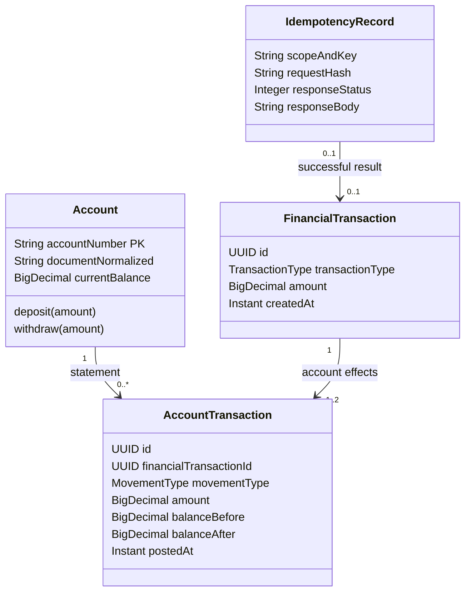

# Desafio técnico — Conta corrente e movimentações

## 1. Objetivo

Construir uma API REST para abertura e movimentação de contas correntes, com consulta de extrato. A solução deve manter o saldo e o histórico consistentes mesmo com requisições concorrentes ou falhas durante uma operação. Este arquivo registra decisões planejadas; o repositório ainda contém apenas o projeto inicial gerado pelo Spring Tools.

## 2. Tecnologias

- Java 21
- Spring Boot 4.1.2
- Spring Web para a API REST
- Spring Data JPA / Hibernate para persistência
- PostgreSQL
- Flyway para versionar o esquema do banco
- Maven para build e dependências
- Docker Compose poderá ser adicionado depois; o primeiro ambiente de desenvolvimento usa a aplicação no Eclipse e um banco PostgreSQL separado no servidor S20

Não implementaremos autenticação, conforme permitido pelo enunciado. A aplicação será um monólito modular: simples de executar e com responsabilidades separadas para facilitar evolução.

## 3. Escopo funcional

1. Abrir uma conta corrente.
2. Depositar em uma conta.
3. Sacar de uma conta.
4. Transferir entre contas.
5. Consultar extrato por intervalo de datas, inclusive períodos passados, com saldo final do período.

## 4. Premissas de negócio

O enunciado não define todas as regras. Para a primeira versão, adotamos as seguintes premissas e decisões de negócio:

- A conta é aberta com saldo zero.
- Cada CPF/CNPJ normalizado pode estar associado a uma única conta; a coluna `document` tem restrição `UNIQUE`.
- Os endpoints REST de saque e transferência não podem tornar o saldo negativo: a operação só é aceita quando o saldo corrente cobre o valor integral. O banco pode apresentar saldo negativo se for alterado por fora da API, cenário possível mas fora do escopo funcional; nesse caso, saque e transferência continuam recusados até haver saldo suficiente.
- Valores de movimentação são positivos e expressos em reais e centavos, com até duas casas decimais. A API rejeita mais de duas casas em vez de arredondar silenciosamente. O código usa `BigDecimal`; o banco usa `NUMERIC(19,2)`. Lançamentos contabilizados ficam em centavos. Cálculos futuros de juros ou índices poderão ter precisão intermediária maior, com regra de arredondamento explícita antes do lançamento. A exibição formata o valor, sem alterar o valor contábil.
- CPF/CNPJ é armazenado como texto normalizado, sem pontos, barras ou hífens e preservando zeros à esquerda. A API aceita o identificador com ou sem pontuação e normaliza antes da validação e persistência. CPF contém 11 dígitos. CNPJ contém 14 posições: os 12 primeiros caracteres podem ser letras ou números e os dois últimos são dígitos verificadores numéricos; letras são normalizadas para maiúsculas. Validar formato e dígitos verificadores conforme a regra oficial da Receita Federal antes de persistir.
- Cada conta possui oito algarismos aleatórios e um dígito verificador calculado pelo módulo 11: da direita para a esquerda, multiplicar pelos pesos `2` a `9`, repetindo a sequência; calcular `11 - (soma mod 11)`; se o resultado for `10` ou `11`, usar `0`. O número completo é único e protegido por chave primária no banco. A API consulta a existência do candidato e tenta outro em caso de colisão; a restrição no banco também protege contra colisões concorrentes entre instâncias.
- O extrato recebe período obrigatório (`from` e `to`), permite consultar meses anteriores e apresenta saldo de abertura, movimentações do período e saldo de fechamento. Os saldos são calculados a partir do histórico de `account_transaction`; não se persiste um saldo arbitrário para cada período consultado. As movimentações são ordenadas por `posted_at` crescente e, em caso de empate, por `id` crescente para manter a paginação estável.
- Os parâmetros do período são datas no fuso `America/Sao_Paulo`; ambos os dias informados são incluídos. A implementação converte o limite final para o início do dia seguinte, usando intervalo técnico semiaberto.
- Depósitos, saques e transferências confirmados não são apagados nem editados. Correções futuras deverão ser feitas por lançamentos compensatórios.
- Toda requisição que altera dados (`POST /accounts`, depósitos, saques ou transferências) exige `Idempotency-Key`, um identificador opaco fornecido pelo chamador. A mesma chave deve ser reutilizada em retries da mesma operação; uma nova operação usa nova chave. O servidor calcula e persiste um hash dos dados relevantes do pedido: mesma chave e mesmo hash reproduzem o resultado original; mesma chave com conteúdo diferente retorna conflito. As chaves são únicas globalmente entre esses endpoints e seus resultados ficam no PostgreSQL para funcionar entre instâncias e após reinícios. A chave não é autenticação nem autorização.

### Precisão monetária

Não há uma regra única publicada que determine como todos os bancos armazenam internamente saldos e cálculos. Para este desafio, escolhemos uma regra clara para operações em reais: os lançamentos efetivados em conta corrente usam centavos (`NUMERIC(19,2)` no PostgreSQL e `BigDecimal` no Java). A documentação do PostgreSQL recomenda `numeric` quando se exige exatidão e alerta que `money` depende de configuração regional; a API Pix do Banco Central usa valores monetários com duas casas no contrato externo. Essas referências sustentam a escolha da representação do desafio, mas não descrevem os sistemas internos de todos os bancos.

Os endpoints de depósito, saque e transferência rejeitam entrada com mais de duas casas decimais; não arredondam silenciosamente. Caso sejam adicionados juros ou outros cálculos fracionários no futuro, o cálculo poderá manter precisão intermediária maior, mas a regra de arredondamento e o momento de contabilização deverão ser definidos pelo produto antes de gerar lançamentos. Formatar `30.00` como `R$ 30,00` é apenas apresentação; não deve mudar a quantia registrada.

## 5. Modelo de dados inicial

### `account`

- `account_number`: número público completo da conta, incluindo o dígito verificador (por exemplo, `12345678-9`), armazenado como texto (`VARCHAR(10)`); chave primária e identificador usado pela API.
- `document`: CPF/CNPJ normalizado (`VARCHAR(14)`).
- `balance`: saldo atual assinado em `NUMERIC(19,2)`, mantido para validar operações e responder consultas rápidas. Pode ser negativo se o banco for alterado fora da API. Deve ser atualizado na mesma transação que grava os lançamentos.
- `created_at`: instante de abertura.
- Restrição `UNIQUE` em `document`, permitindo uma conta por CPF/CNPJ.

### `account_transaction`

- `id`: UUID, chave primária.
- `account_number`: FK para `account.account_number`, identificando a conta afetada.
- `financial_transaction_id`: FK para a operação financeira que originou este movimento.
- `movement_type`: enum `CREDIT` ou `DEBIT`, indicando o efeito na conta.
- `amount`: valor positivo em `NUMERIC(19,2)`.
- `balance_before` e `balance_after`: saldo da conta imediatamente antes e depois da movimentação, gravados na mesma transação. Servem como evidência de auditoria e não substituem o histórico para calcular extratos.
- `description`: descrição opcional.
- `posted_at`: instante de efetivação, gerado pelo PostgreSQL como `TIMESTAMPTZ DEFAULT clock_timestamp()`.

### `financial_transaction`

- `id`: UUID, chave primária e identificador da operação.
- `transaction_type`: enum `DEPOSIT`, `WITHDRAWAL` ou `TRANSFER`, indicando a operação financeira.
- `amount`: valor da operação em `NUMERIC(19,2)`.
- `created_at`: instante de criação da operação.

Cada depósito e saque cria um registro em `financial_transaction` e um registro correspondente em `account_transaction`. Uma transferência cria um registro em `financial_transaction` e dois em `account_transaction`: um `DEBIT` na conta de origem e um `CREDIT` na conta de destino. Cada movimento referencia a operação por `financial_transaction_id`. Os registros envolvidos e as atualizações de saldo são persistidos atomicamente. O cadastro da conta não cria operação financeira. Tentativas rejeitadas não aparecem no histórico financeiro.

O PostgreSQL gera `posted_at` no momento da gravação. O extrato usa o campo para filtrar o período e ordena por `posted_at ASC, id ASC`. O identificador desempata horários iguais para que a paginação permaneça estável; a ordem não altera o saldo agregado do período.

Para um extrato, o saldo de abertura é a soma líquida das movimentações anteriores a `from`; o saldo de fechamento é o saldo de abertura mais a soma líquida das movimentações no período. O saldo atual em `account` é um valor operacional atualizado junto com `account_transaction`, não um snapshot por período. Índices por conta e horário permitem filtrar as movimentações consultadas.

Se uma intervenção operacional futura ajustar o saldo diretamente, também deverá registrar uma movimentação de ajuste auditável na mesma transação. Alterar somente `account.balance` faria o extrato calculado pelo histórico divergir do saldo corrente. Esse processo administrativo não faz parte dos endpoints deste desafio.

### `idempotency_record`

- Escopo e chave idempotente, com restrição única.
- A chave opaca recebida no cabeçalho `Idempotency-Key` e um hash calculado pelo servidor a partir dos dados relevantes da requisição. O hash detecta uso da mesma chave com conteúdo diferente; não é enviado pelo chamador.
- `financial_transaction_id` (nulo para abertura de conta ou quando não há operação financeira efetivada), resultado HTTP e corpo da resposta original necessários para repetir o resultado sem reexecutar efeitos. Na abertura, o corpo persistido contém o número da conta criada.
- Para requisição bem formada que entrou no processamento, registrar tanto sucesso quanto rejeição de regra de negócio, incluindo documento já associado a uma conta e saldo insuficiente. Uma chave repetida reproduz a resposta original; para uma nova tentativa após saldo insuficiente, o cliente envia uma nova chave.
- As chaves e seus resultados não expiram: são mantidos para impedir que uma repetição tardia execute novamente uma operação financeira.
- Registro gravado na mesma transação da abertura de conta ou, para operações financeiras, de `financial_transaction`, `account_transaction` e atualização de saldo. Para rejeições de regra de negócio, gravar somente o resultado idempotente, sem efeitos financeiros ou abertura de conta.

Essa tabela torna a proteção contra duplicidade efetiva mesmo com várias instâncias da aplicação, reinícios ou timeout depois do commit.

## 6. Comportamento do modelo

### Conceitos e responsabilidades

| Conceito | Responsabilidade e regras |
|---|---|
| `Account` | Mantém identidade da conta e saldo corrente operacional. O documento normalizado é único e só pode haver uma conta por CPF/CNPJ. Abre com zero. Aceita crédito positivo. Só aceita débito quando `balance >= amount`; essa regra impede os endpoints de criar saldo negativo. |
| `financial_transaction` | Registro da operação financeira: enum `TransactionType` (`DEPOSIT`, `WITHDRAWAL`, `TRANSFER`), valor e instante de criação. |
| `account_transaction` | Registro imutável de crédito ou débito efetivado em uma conta: enum `MovementType` (`CREDIT`, `DEBIT`), valor, `posted_at` e saldos antes/depois. Cada registro referencia uma `financial_transaction`; uma transferência tem dois movimentos associados. |
| `IdempotencyRecord` | Liga chave + hash da requisição ao resultado original, inclusive rejeição por saldo insuficiente, para uma repetição não ser reinterpretada como uma nova tentativa. |
| Casos de uso | Coordenam validação, bloqueios, regras de domínio, persistência e transação. Controller apenas converte HTTP para comandos e respostas. |



### Fluxo de uma movimentação

```mermaid
sequenceDiagram
    actor Client as Cliente
    participant API as REST API
    participant UseCase as Caso de uso
    participant DB as PostgreSQL
    Client->>API: comando + Idempotency-Key
    API->>UseCase: validar formato e criar comando + Idempotency-Key
    UseCase->>DB: BEGIN; verificar/reservar Idempotency-Key
    alt chave já processada com mesmo conteúdo
        DB-->>UseCase: resposta original
        UseCase-->>API: repetir status e corpo originais
    else chave usada com conteúdo diferente
        UseCase-->>API: 409 IDEMPOTENCY_CONFLICT
    else chave nova
        UseCase->>DB: bloquear conta(s) em ordem estável (SELECT FOR UPDATE)
        UseCase->>UseCase: aplicar regra de negócio
        alt saldo insuficiente
            UseCase->>DB: salvar resposta idempotente 422
            Note over UseCase,DB: Sem account_transaction ou alteração do saldo
            DB-->>UseCase: commit do resultado idempotente
        else operação aceita
            UseCase->>DB: atualizar saldo + inserir financial_transaction + account_transaction(s)
            UseCase->>DB: salvar resposta idempotente
            DB-->>UseCase: commit atômico
        end
        UseCase-->>API: resposta armazenada
    end
    API-->>Client: status e JSON
```

Erros de formato (`400`), inclusive ausência de `Idempotency-Key`, são rejeitados antes de abrir a transação. A existência da conta e regras que dependem do estado atual, como saldo suficiente ou documento já cadastrado, são verificadas dentro da transação depois de adquirir os locks necessários. A abertura e cada movimentação são síncronas e gravam efeitos e resposta idempotente na mesma transação. Rejeições de regra de negócio gravam somente a resposta idempotente. Falha técnica antes do commit desfaz todos os efeitos e a reserva da chave; o cliente pode repetir com a mesma chave. Não persistimos estado `PENDING`; processamento assíncrono fica fora do escopo atual.

### Regras por caso de uso

- **Abertura:** validar `Idempotency-Key`, normalizar CPF/CNPJ e validar formato/dígitos; dentro da transação, detectar documento já cadastrado e retornar `409` seguro, ou gerar número aleatório de oito algarismos com dígito calculado, persistir a conta como PK com saldo zero e gravar a resposta idempotente. A operação não aceita saldo inicial informado pelo cliente.
- **Depósito:** validar valor positivo; bloquear a conta; ler e atualizar saldo; gravar `financial_transaction` do tipo `DEPOSIT` e `account_transaction` de crédito com saldos anterior/posterior; armazenar resposta idempotente — tudo no mesmo commit.
- **Saque:** validar valor positivo; bloquear a conta; verificar `saldo >= valor`; se insuficiente, armazenar resposta idempotente `422` sem operação, movimentação ou alteração do saldo; caso contrário, reduzir saldo e gravar `financial_transaction` do tipo `WITHDRAWAL` e `account_transaction` de débito no mesmo commit.
- **Transferência:** validar contas distintas e valor positivo; bloquear origem e destino em ordem determinística; validar saldo da origem; se insuficiente, armazenar resposta idempotente `422` sem operação ou movimentações; se suficiente, gravar uma `financial_transaction` do tipo `TRANSFER`, atualizar ambos os saldos e gravar dois `account_transaction` associados — `DEBIT` na origem e `CREDIT` no destino — no mesmo commit. Qualquer falha técnica desfaz todos os efeitos.
- **Extrato:** consultar `account_transaction` dentro do intervalo por JPA `@Query`, com `ORDER BY t.postedAt ASC, t.id ASC` (mapeado para `posted_at` e `id`); calcular saldo de abertura pela soma líquida anterior ao intervalo e saldo de fechamento somando o período. O `id` desempata apenas para manter estável a paginação quando `posted_at` coincide.

## 7. API proposta

Prefixo: `/api/v1`.

Todas as respostas usam JSON. Valores monetários são strings decimais com duas casas (por exemplo, `"30.00"`) para evitar perda de precisão em clientes. Requisições aceitam até duas casas e rejeitam escala maior; não há arredondamento silencioso. Datas do extrato usam `YYYY-MM-DD`. Os exemplos abaixo descrevem o contrato planejado.

| Método e endpoint | Requisição | Sucesso esperado |
|---|---|---|
| `POST /accounts` | Cabeçalho `Idempotency-Key`; `{ "document": "12345678901" }` (CPF ou CNPJ, com ou sem pontuação) | `201 Created`: `{ "accountNumber": "12345678-9", "balance": "0.00", "createdAt": "<instante>" }`. O documento é normalizado e não é ecoado na resposta. |
| `GET /accounts/{accountNumber}` | Número público completo da conta, incluindo dígito verificador | `200 OK`: `{ "accountNumber": "12345678-9", "documentMasked": "***.***.***-01", "balance": "<saldo atual>" }`. |
| `POST /transactions/deposits` | Cabeçalho `Idempotency-Key`; `{ "accountNumber": "12345678-9", "amount": "30.00", "description": "<opcional>" }` | `201 Created`: `{ "financialTransactionId": "<uuid>", "type": "DEPOSIT", "amount": "30.00", "status": "SUCCEEDED", "postedAt": "<instante>" }`. |
| `POST /transactions/withdrawals` | Cabeçalho `Idempotency-Key`; `{ "accountNumber": "12345678-9", "amount": "30.00", "description": "<opcional>" }` | `201 Created`: `{ "financialTransactionId": "<uuid>", "type": "WITHDRAWAL", "amount": "30.00", "status": "SUCCEEDED", "postedAt": "<instante>" }`. |
| `POST /transactions/transfers` | Cabeçalho `Idempotency-Key`; `{ "sourceAccountNumber": "12345678-9", "destinationAccountNumber": "87654321-0", "amount": "30.00", "description": "<opcional>" }` | `201 Created`: `{ "financialTransactionId": "<uuid>", "type": "TRANSFER", "amount": "30.00", "status": "SUCCEEDED", "postedAt": "<instante>" }`. |
| `GET /accounts/{accountNumber}/statement?from=YYYY-MM-DD&to=YYYY-MM-DD&page=1&size=20` | Conta, datas inicial/final; `page` e `size` opcionais | `200 OK`: `{ "accountNumber": "12345678-9", "from": "<data>", "to": "<data>", "openingBalance": "<saldo>", "entries": [{ "financialTransactionId": "<uuid>", "transactionType": "DEPOSIT", "movementType": "CREDIT", "amount": "30.00", "description": "<texto>", "postedAt": "<instante>" }], "closingBalance": "<saldo>", "page": 1, "size": 20, "numberOfElements": 1, "totalEntries": 1 }`. `page` começa em `1` (padrão); `size` tem padrão `20` e máximo `100`. `page < 1`, `size < 1` ou `size > 100` retorna `400`. Uma página além da última retorna `200 OK`, `entries: []` e `numberOfElements: 0`. Os saldos abrangem o período inteiro, ainda que as movimentações sejam paginadas. Registros com o mesmo `postedAt` são desempatados por `id ASC`. |

O chamador cria uma chave opaca e a envia no cabeçalho `Idempotency-Key` em `POST /accounts` e nas requisições financeiras. Em retry da mesma operação, reapresenta a mesma chave; para nova operação, cria outra. O servidor calcula o hash da requisição e persiste chave, hash e resultado. Uma repetição com a mesma chave e mesmo conteúdo devolve o resultado original, sem repetir a abertura ou movimentação. Reutilizar a chave com conteúdo diferente gera `409 Conflict`. A chave não concede acesso à conta nem substitui autenticação/autorização.

### Contrato de erros

Formato comum: `{ "code": "<código estável>", "message": "<mensagem segura>" }`. Não incluir saldo atual, CPF/CNPJ, credenciais, conteúdo integral do pedido ou detalhe técnico. A resposta não expõe identificador de correlação.

| HTTP | Código | Quando ocorre | Mensagem segura esperada |
|---|---|---|---|
| `400 Bad Request` | `VALIDATION_ERROR` | Campo obrigatório ausente, `Idempotency-Key` ausente, formato/dígito da conta inválido, valor não positivo, datas inválidas, `page < 1`, `size < 1` ou `size > 100`, ou conta de origem igual à de destino | `Verifique os dados enviados.` |
| `404 Not Found` | `RESOURCE_NOT_FOUND` | Conta consultada ou movimentada não encontrada | `Recurso não encontrado.` |
| `409 Conflict` | `ACCOUNT_CONFLICT` | Tentativa de abrir outra conta para CPF/CNPJ que já possui uma | `Não foi possível abrir a conta com os dados informados.` |
| `409 Conflict` | `IDEMPOTENCY_CONFLICT` | Chave idempotente já usada com outro conteúdo | `A chave de idempotência não pode ser reutilizada com dados diferentes.` |
| `422 Unprocessable Content` | `INSUFFICIENT_FUNDS` | Saldo insuficiente para saque ou transferência | `Saldo insuficiente para concluir a operação.` |
| `500 Internal Server Error` | `INTERNAL_ERROR` | Falha inesperada da aplicação ou indisponibilidade técnica do banco | `Não foi possível concluir a solicitação.` |

**Racional de privacidade para `ACCOUNT_CONFLICT`:** como a API do desafio não terá autenticação, responder explicitamente “já existe uma conta para este CPF/CNPJ” permitiria a qualquer chamador testar documentos e descobrir quais estão associados a contas. O status permanece `409`, mas o código e a mensagem não confirmam a existência do cadastro nem repetem o documento. Essa decisão reduz exposição de dados pessoais e deve ser explicada na apresentação como uma escolha deliberada de privacidade, não como falta de detalhe no tratamento do erro.

## 8. Integridade e concorrência

- Cada operação financeira é executada em uma transação de banco de dados.
- Validações estruturais — campos obrigatórios, formato dos identificadores, valor positivo e precisão decimal — ocorrem antes de abrir a transação. Dentro dela, o caso de uso obtém o lock da(s) conta(s) e então verifica existência e regras que dependem do estado corrente, como saldo suficiente; a decisão de debitar não usa uma consulta de saldo anterior ao lock.
- Não persistir estado `PENDING`; a movimentação REST é síncrona e seus efeitos só ficam visíveis juntos no commit.
- O depósito bloqueia a linha da conta, lê e atualiza o saldo corrente, grava uma `financial_transaction` (`DEPOSIT`) e uma `account_transaction` (`CREDIT`) com `balance_before`/`balance_after`, e salva a resposta idempotente, tudo atomicamente.
- O saque bloqueia a linha da conta, valida `saldo >= valor` (se o saldo já estiver negativo por alteração externa, o saque é recusado), grava uma `financial_transaction` (`WITHDRAWAL`) e uma `account_transaction` (`DEBIT`), e atualiza o saldo na mesma transação.
- A transferência bloqueia as duas contas em ordem determinística, valida `saldo da origem >= valor`, grava uma `financial_transaction` (`TRANSFER`), dois registros associados em `account_transaction` (`DEBIT` na origem e `CREDIT` no destino) e atualiza os dois saldos na mesma transação.
- Duas operações com chaves diferentes sobre a mesma conta são serializadas pelo bloqueio da linha: a segunda espera pelo commit da primeira e valida o saldo já atualizado.
- Duas chamadas concorrentes com a mesma chave são serializadas pela restrição única da chave idempotente: a segunda aguarda o resultado da primeira e reproduz a resposta, sem duplicar os efeitos.
- O bloqueio dura somente o trabalho no banco; não manter a conta bloqueada enquanto a aplicação faz chamadas externas ou trabalho demorado.
- Uma falha em qualquer etapa deve causar rollback de todos os efeitos daquela operação.
- Restrições no PostgreSQL protegem invariantes como unicidade de conta e valores de movimentação positivos. A regra de que os endpoints não podem gerar saldo negativo é verificada dentro da transação, depois de bloquear a conta. Não há `CHECK (balance >= 0)`, pois um saldo negativo existente por alteração externa deve poder ser representado.
- O histórico imutável de `account_transaction` é a fonte para calcular extratos de qualquer período e a trilha de auditoria. O saldo atual da conta é mantido como valor operacional; atualização de saldo e gravação de `financial_transaction`/`account_transaction` sempre acontecem na mesma transação. Os dois lados de uma transferência referenciam a mesma `financial_transaction`.
- O extrato usa Spring Data JPA `@Query` para filtrar o intervalo e aplicar `ORDER BY t.postedAt ASC, t.id ASC`; consultas explícitas também calculam os saldos agregados de abertura e fechamento. A API expõe `page` iniciado em `1` e converte internamente para o índice iniciado em `0` exigido pelo Spring Data.
- Índices serão criados para `(account_number, posted_at)` e para a chave idempotente.

## 9. Organização do código

Separar por domínio, mantendo responsabilidades claras:

- `account`: abertura e consulta de contas.
- `transaction`: depósito, saque e transferência.
- `statement`: consulta de extrato.
- `shared`: tratamento comum de erros, configuração e tipos compartilhados.

Dentro de cada área, separar API (controllers e DTOs), aplicação/regras de negócio, domínio e persistência. Entidades JPA não serão expostas diretamente nos endpoints.

## 10. Erros da API

Usar respostas consistentes, com código HTTP e código de erro estável. As mensagens ajudam a entender a ação, mas não revelam saldo, CPF/CNPJ, dados completos da conta, chaves idempotentes, SQL, stack trace ou detalhes internos. Por exemplo, saldo insuficiente pode retornar `INSUFFICIENT_FUNDS` e a mensagem `Saldo insuficiente para concluir a operação.`, sem informar o saldo atual nem repetir detalhes desnecessários da requisição. Identificadores técnicos de requisição, se usados, ficam apenas nos logs internos.

Casos previstos:

- `400`: dados inválidos, valor não positivo ou intervalo de datas inválido.
- `404`: conta inexistente.
- `409`: chave de idempotência reutilizada com conteúdo diferente ou conflito de unicidade.
- `500`: falha inesperada, sem expor detalhes internos ou dados sensíveis.

O status de saldo insuficiente será ajustado para `422` (regra de negócio não atendida), separando-o de conflitos de idempotência (`409`). Uma resposta de erro não deve ecoar os valores sensíveis recebidos. Erros inesperados retornam texto genérico; o detalhe técnico fica restrito aos registros internos.

## 11. Privacidade, LGPD e proteção contra vazamento

CPF é dado pessoal. CNPJ é um identificador de pessoa jurídica, mas pode estar associado a uma pessoa natural identificável; ambos serão tratados com minimização e cuidado. Coletar apenas os campos necessários para o desafio, não devolver o identificador completo em respostas comuns e mascará-lo quando houver necessidade de exibição. Não usar dados reais em desenvolvimento ou exemplos.

- Não registrar corpo de requisição/resposta, CPF/CNPJ, saldo, credenciais ou cabeçalhos sensíveis em logs. Registrar apenas evento, horário, identificador interno da operação e código de erro, com acesso controlado. Falhas técnicas detalhadas ficam nos logs internos e não em uma tabela de erros de negócio nem na resposta HTTP.
- Não incluir dados pessoais em URL, mensagens de erro ou identificadores técnicos internos.
- Restringir acesso ao banco e aos logs; credenciais ficam fora do repositório. Em produção, usar transporte protegido e gestão adequada de segredos.
- Não expor entidades JPA ou mensagens de exceção diretamente pela API.
- Definir retenção e descarte de dados de acordo com as obrigações aplicáveis antes de qualquer uso real. O desafio não determina base legal, prazos de retenção ou processo de atendimento aos direitos dos titulares; essas decisões dependem da cooperativa e não serão inventadas no código de demonstração.

Como o enunciado dispensa autenticação, a implementação do desafio é demonstrativa e não deve ser tratada como API pronta para acesso público a dados ou movimentações reais. A proteção completa de extratos e operações depende de autenticação, autorização por titularidade da conta e controles operacionais que estão fora do escopo técnico solicitado.

## 12. Execução e documentação do repositório

O repositório deverá incluir:

- `README.md` com pré-requisitos, configuração, comandos de execução e exemplos de uso.
- `docs/DECISOES_TECNICAS.md` (este documento) com premissas, modelo e decisões de consistência.
- `compose.yaml` poderá ser incluído futuramente para desenvolvimento local isolado; não é requisito para a primeira execução.
- Migrações Flyway para criação e evolução do esquema.
- Configuração externa via variáveis de ambiente, sem credenciais reais versionadas.

## 13. Sequência de implementação

1. Criar o esqueleto Spring Boot 4.1.2 / Java 21 e configurar conexão com um banco PostgreSQL dedicado no S20.
2. Criar migrações e persistência de conta e movimentação.
3. Implementar abertura e consulta de conta.
4. Implementar depósito e saque com transação e idempotência.
5. Implementar transferência atômica com bloqueio das contas.
6. Implementar extrato com período e saldo final.
7. Completar README com exemplos de requests e decisões operacionais.

## 14. Pontos para considerar antes de uso real

As decisões funcionais e de contrato necessárias ao desafio estão definidas. Antes de uso real, será necessário implantar autenticação e autorização por titularidade, definir políticas legais de retenção/arquivamento e reavaliar a capacidade do número de conta de oito algarismos aleatórios (100 milhões de combinações-base) conforme a projeção de crescimento. As chaves idempotentes não expiram no modelo atual.

Referência de privacidade: [Lei nº 13.709/2018 (LGPD), texto oficial](https://www.planalto.gov.br/ccivil_03/_ato2015-2018/2018/lei/l13709.htm).

Referências técnicas: [tipos numéricos do PostgreSQL](https://www.postgresql.org/docs/current/datatype-numeric.html), [tipo monetário do PostgreSQL](https://www.postgresql.org/docs/current/datatype-money.html), [funções de data e hora do PostgreSQL](https://www.postgresql.org/docs/current/functions-datetime.html), [API Pix do Banco Central](https://github.com/bacen/pix-api), [Java `BigDecimal`](https://docs.oracle.com/en/java/javase/21/docs/api/java.base/java/math/BigDecimal.html), [consultas do Spring Data JPA](https://docs.spring.io/spring-data/jpa/reference/jpa/query-methods.html) e [orientação oficial sobre CNPJ alfanumérico](https://www.gov.br/receitafederal/pt-br/acesso-a-informacao/acoes-e-programas/programas-e-atividades/cnpj-alfanumerico).


